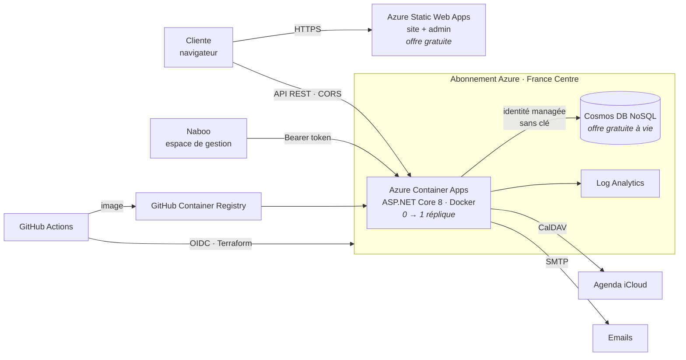

# Naboo Cloud — prise de rendez-vous sur Azure

Application de réservation pour **Naboo**, coiffure afro à Poitiers : site public, espace de gestion,
synchronisation en temps réel avec l'agenda iCloud. Version « cloud native » sur **Microsoft Azure**,
conçue pour rester dans les **offres gratuites**.

## Architecture



| Couche | Service | Pourquoi |
|---|---|---|
| Front | Azure Static Web Apps (Free) | HTML/CSS/JS statique servi par CDN, HTTPS inclus |
| API | ASP.NET Core 8 (minimal API) dans Azure Container Apps | conteneur Docker, mise à l'échelle à zéro, quota mensuel gratuit |
| Données | Azure Cosmos DB for NoSQL (free tier) | 1000 RU/s et 25 Go gratuits à vie, plafonnés par Terraform |
| Secrets | Secrets Container Apps + identité managée | aucune clé de base de données, aucun mot de passe Azure dans GitHub |
| Infra | Terraform (azurerm 4.x), état distant dans Azure Storage | infrastructure reproductible et versionnée |
| CI/CD | GitHub Actions + OIDC | tests → image → Terraform → site → test de fumée à chaque push |

## Fonctionnalités

- **Cliente** : choix de la prestation, du jour et du créneau, réservation à domicile, acompte Wero, emails.
- **Naboo** : valider (→ événement iCloud + email avec `.ics`), refuser, annuler, supprimer ; horaires, jours fermés,
  créneaux bloqués, ouvertures exceptionnelles, prestations, prix, réglages ; statistiques anonymes.

## Sécurité

- Espace de gestion : mot de passe haché **PBKDF2-SHA256** (210 000 itérations), jetons de session **HMAC-SHA256**
  sans état (6 h), blocage après 8 échecs, **limitation de débit** par IP (connexion, réservations, API).
- Cosmos DB : **authentification par clé désactivée**, accès uniquement via l'identité managée de l'API (RBAC).
- GitHub → Azure : **OIDC** (identifiants fédérés), aucun secret Azure stocké.
- CORS restreint au domaine du site, en-têtes de sécurité, conteneur **non root**, validation stricte côté serveur.
- Lien « Examiner la demande » protégé par un jeton aléatoire comparé en temps constant ; jamais exposé par l'API d'admin.
- Statistiques sans cookie ni identifiant (pas de bandeau de consentement nécessaire).

## Coûts

Prévu pour **0 €** : Static Web Apps Free, quota gratuit mensuel de Container Apps (180 000 vCPU-s, 2 M de requêtes),
Cosmos DB free tier (débit plafonné à 1000 RU/s par Terraform), GHCR gratuit pour un dépôt public.
Log Analytics est plafonné à 0,1 Go/jour. Avec **Azure for Students** (100 $/an, sans carte bancaire),
le compte de stockage de l'état Terraform (quelques centimes) est couvert par le crédit.

## Structure

```
src/Naboo.Api/        API ASP.NET Core 8
  Domain/             logique métier pure (créneaux, réglages, iCalendar, dates)
  Services/           cas d'usage (réservation, validation, statistiques)
  Stockage/           Cosmos DB + implémentation mémoire (tests, dev)
  Integrations/       iCloud CalDAV, SMTP (+ versions simulées)
  Securite/           mots de passe, jetons, anti-force brute
tests/Naboo.Api.Tests/ tests unitaires + tests d'intégration (WebApplicationFactory)
web/                  site public (index.html) et espace de gestion (admin.html)
infra/                Terraform
scripts/              préparation Azure, outil iCloud
.github/workflows/    CI (PR) et déploiement (main)
```

## Développement local

```bash
dotnet test                                   # tous les tests
cd src/Naboo.Api && dotnet run                # API sur http://localhost:5xxx, stockage en mémoire
# Dans web/config.js : window.NABOO_API = 'http://localhost:5xxx';  puis ouvrir web/index.html
```
Variable `ADMIN_MOT_DE_PASSE` pour se connecter à l'espace de gestion en local (10 caractères minimum),
`CORS_ORIGINES` pour autoriser l'origine du site.

## Déploiement (une seule fois, ≈ 20 min, faisable depuis un téléphone)

1. **Azure** : créer un compte [Azure for Students](https://azure.microsoft.com/free/students) avec l'email de l'école.
2. **Cloud Shell** : sur portal.azure.com, ouvrir *Cloud Shell* (Bash) et lancer :
   ```bash
   curl -fsSL https://raw.githubusercontent.com/Mama2703/naboo-cloud/main/scripts/bootstrap-azure.sh | bash
   ```
   Le script affiche 5 valeurs à copier.
3. **GitHub → Settings → Secrets and variables → Actions** :
   - onglet **Variables** : les 5 valeurs du script, plus `EMAIL_PROPRIETAIRE`, et si utilisés
     `ICLOUD_IDENTIFIANT`, `ICLOUD_URL_CALENDRIER`, `SMTP_HOTE` (ex. `smtp.gmail.com`), `SMTP_UTILISATEUR` ;
   - onglet **Secrets** : `ADMIN_MOT_DE_PASSE` (10 caractères min.), et si utilisés
     `ICLOUD_MOT_DE_PASSE_APP`, `SMTP_MOT_DE_PASSE` (mot de passe d'application Gmail/Outlook).
4. **Actions → Déploiement Azure → Run workflow.** Au premier passage, rendre le paquet Docker public
   (profil GitHub → *Packages* → `naboo-cloud` → *Package settings* → *Change visibility* → *Public*), puis relancer.
5. Le résumé du workflow donne les adresses du site, de l'espace de gestion et de l'API.

Ensuite, chaque `git push` sur `main` teste, reconstruit et redéploie tout automatiquement.

> L'état Terraform contient les secrets de l'application : il est stocké chiffré dans le compte de stockage privé
> `rg-naboo-tfstate`, accessible uniquement par l'identité de déploiement et la propriétaire de l'abonnement.
